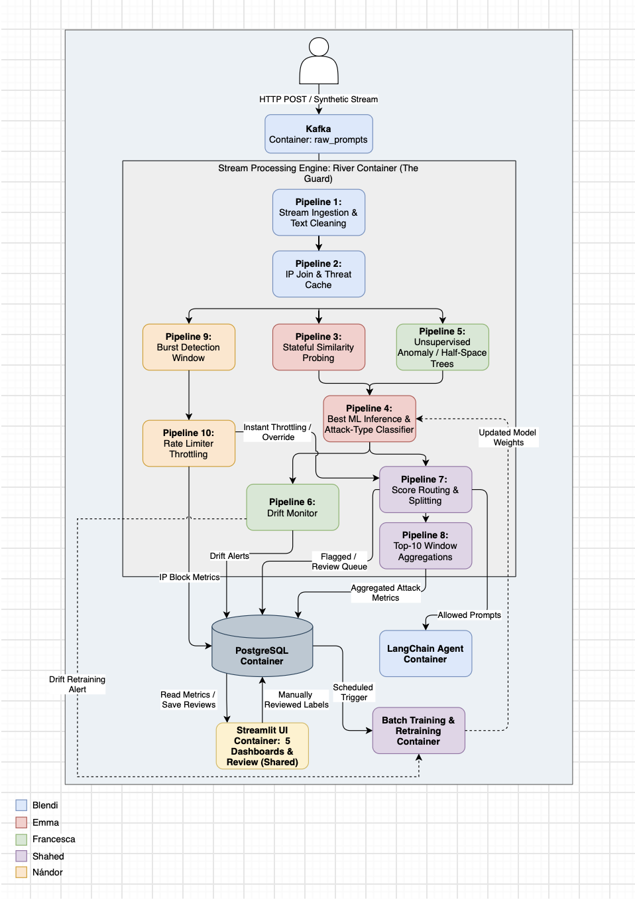

# Project report: PIJD Prompt Guard

[README](../../README.md) | [Developer guide](developer-guide.md) | [Research-paper notes](research-papers.md)

**Archive note:** This report describes the completed experiments. The supporting backend
tools, notebooks, tests, baseline models, and training history under `Others/backend/`
were subsequently deleted. References to those files describe the historical setup.

## Abstract

Prompt injection and jailbreak attacks can be used to divert an AI agent from its normal function. This project is the development of a streaming guard that checks prompts before they are passed to a LangChain agent. The guard is built on Kafka and PostgreSQL and incorporates ten processing stages. We compare TF-IDF and frozen MiniLM embeddings with Logistic Regression for the binary detection task and train a multiclass classifier to detect the attack family. We train the embedding based classifier using NeurAlchemy and evaluate it on two external datasets. The final Batch 2 model achieved a macro-F1 of 0.94 on the NeurAlchemy test split and 0.66 and 0.62 on deepset and jackhhao respectively, showing weaker generalisation to external prompts. The guard makes a decision to allow, block or review the prompt and stores the results for analysis in a dashboard. This project demonstrates how prompt screening and monitoring can be integrated into an AI agent’s workflow before a prompt is executed. It also highlights the importance of human review and evaluation on varied prompts to identify weaknesses and guide future retraining of the guard.

## Introduction

AI agents may act on untrusted user input or external content when processing natural-language requests. The model can be redirected from its intended task or produce unsafe outputs by prompt-injection and jailbreak attacks. Programmable guardrails add an extra check before an agent acts because training-time alignment alone may not enforce every application-specific rule at runtime ([Rebedea et al., 2023](https://doi.org/10.18653/v1/2023.emnlp-demo.40)). Hence, this project builds a prompt-injection and jailbreak guard.

The system uses ten streaming pipelines: **P1** ingests prompts and cleans text; **P2** adds source context; **P3** checks similarity to known attack prompts; **P4** classifies prompts and predicts attack types; **P5** detects anomalous prompts; **P6** monitors score drift; **P7** routes prompts to allow, block, or review; **P8** aggregates attack types and repeated patterns; **P9** detects source bursts; and **P10** applies rate limits. Allowed prompts can reach the agent, while the system stores decisions and results for analysis.

The project compares classical and embedding-based binary classifiers in Batches 1 and 2, adds attack-type classification in Batch 3, and evaluates reviewed-label retraining in Batch 4. Across its experiments, it measures model performance on primary and external datasets, runtime latency and throughput, drift and burst behavior, and guarded versus unguarded agent runs. The completed dashboards track decision trends, model comparisons, drift alerts, attack-type and Top-10 pattern summaries, and review-queue and throttling activity. Research on sliding-window stream summaries and model adaptation gives context for these design areas ([Gou et al., 2023](https://doi.org/10.1109/TKDE.2022.3151140); [Lu et al., 2019](https://doi.org/10.1109/TKDE.2018.2876857)).

## Datasets utilised

We used three datasets from Hugging Face. NeurAlchemy was our main dataset for training, validation, and testing. Two smaller datasets, deepset and jackhhao, were kept separate from training and used to check how well the models generalised to prompts from other sources.

### NeurAlchemy

The [NeurAlchemy Prompt Injection Dataset](https://huggingface.co/datasets/neuralchemy/Prompt-injection-dataset) contains benign prompts as well as prompt-injection and jailbreak examples which were used to train the batch 1 and 2 binary classification models. The dataset also includes attack-category labels, which were used for batch 3's multiclass attack classifier.
We kept the dataset's original training, validation, and test splits. Initially, we planned to use only rows marked as neuralchemy_v1 in the source column. However, we later expanded this to include all sources, giving the models a wider variety of prompts to learn from.
For Batch 3, we grouped the original attack categories into six broader families: instruction manipulation, jailbreak/persona manipulation, obfuscation, information extraction, indirect injection/agent manipulation, and adversarial attacks. This reduced the number of separate labels and brought related attack techniques together.

### External evaluation datasets

The deepset/prompt-injections and jackhhao/jailbreak-classification datasets are imported into PostgreSQL for external testing.
They remain excluded from model training and selection, and the evaluation report presents their results separately.
Cross-dataset duplicate prompts are represented by whichever source the importer retained.

## System architecture

### Overall flow

Docker Compose runs Flask, Kafka, PostgreSQL, the guard workers, and the agent worker.
Browser and command-line HTTP submissions enter Kafka's `prompts_raw` topic; dataset replay feeds the same raw-event path.
The intake worker performs P1–P5, while P9/P10 process raw traffic in parallel and P6 monitors stored P4 scores.
P7 combines stored classification and throttling outcomes; only allowed prompts enter `prompts_allowed` for the agent.
P8 reads stored classifications to maintain rolling attack summaries.

### Application setup and Kafka interface

For the backend we used Flask with a browser interface and PostgreSQL for storage. The page has a chat window, and all prompts are saved in PostgreSQL.  Each submitted prompt from the browser is published to Kafka using a validated event contract, and an intake consumer saves it to PostgreSQL.

### Batch models

#### Batch 1: classical binary classification

TF-IDF features with Logistic Regression are used in Batch 1 to classify prompts as benign or malicious. ([Rebedea et al., 2023](https://doi.org/10.18653/v1/2023.emnlp-demo.40)), in NeMo Guardrails, discuss the runtime overhead of programmable guardrails and the potential role of specialized execution-rail models, which motivates a lightweight local classifier in the guard path. Although the paper does not evaluate TF-IDF or Logistic Regression, Batch 1 uses both as the project's classical baseline for comparison.

#### Batch 2: embedding-based binary classification

Batch 2 uses the pretrained all-MiniLM-L6-v2 encoder to convert the prompts into numerical features. The MiniLM encoder outputs dense, 384-dimensional embeddings.
Each prompt is converted into a normalised embedding, which becomes the input to a Logistic Regression classifier that outputs a probability between zero and one representing how likely the prompt is to be malicious.

#### Batch 3: attack-type classification

Batch 3 identifies which of the six attack families a malicious prompt belongs to. We used the same frozen encoder and normalised 384-dimensional embeddings as Batch 2, but trained the classifier only on malicious NeurAlchemy prompts mapped to those families.
This label describes the suspected attack; it does not determine whether the prompt is allowed, blocked, or reviewed.

#### Batch 4: reviewed-label retraining

Batch 4 is an explicit offline command using reviewed benign/malicious labels supplied as a CSV, with rows assigned to training or validation. This follows a model-update pattern in which expert feedback is incorporated as labelled data and used to retrain a supervised model; the CSV workflow and promotion rule here are project-specific choices ([Chen et al., 2023](https://doi.org/10.1016/j.patter.2023.100780)). Promotion replaces the active Batch 2 classifier only if the candidate's validation macro-F1 is strictly higher than the current classifier's score on the same labelled validation rows. 

Operational instructions are in the [developer guide](developer-guide.md#batch-4-reviewed-label-retraining).

### P1/P2: ingestion, preprocessing and source enrichment
 
P1 produces a Unicode-normalized, whitespace cleaned prompt and gets the character count, word count, and symbol ratio. The original text remains unchanged for classification and agent execution. P2 adds source context using allow, block, and review counts from the preceding ten minutes.

### P3/P4: similarity and classification

For each incoming prompt within the model’s 256-token limit, the intake worker creates one normalised, 384-dimensional embedding using the pretrained `all-MiniLM-L6-v2` encoder. The encoder’s weights remain frozen during processing. This prompt embedding is used for P3 similarity probing and P4 classification.

P3 compares the incoming embedding with two reference collections: malicious prompts from the NeurAlchemy training data and recent prompts that P4 predicted to be malicious with high confidence using cosine similarity. P3 returns the closest reference and its similarity score. A similar embedding-based cosine comparison is described in [PromptGuard: A structured framework for injection-resilient language models](https://www.nature.com/articles/s41598-025-31086-y) by Ahmed Alzahrani. The numerical similarity score is stored in PostgreSQL and used as a feature by P5’s anomaly detector. 

P4 applies the trained Batch 2 classifier to estimate whether the incoming prompt is benign or malicious. Combining pretrained text embeddings with traditional classifiers for jailbreak detection has also been explored by ([Galinkin and Sablotny, 2024](https://arxiv.org/abs/2412.01547)). When the maliciousness probability is at least 0.5, Batch 3 also predicts one of the six attack families using the same embedding.

### P5 streaming anomaly detection

P5 adds an unsupervised, per-prompt anomaly score in the intake consumer after P4 and uses River's Half-Space Trees implementation. A comparative study of online anomaly detectors includes HST/F among tree-based methods and analyzes accuracy and efficiency trade-offs across data characteristics ([Ntroumpogiannis et al., 2023](https://doi.org/10.1007/s00778-022-00773-x)); River provides the streaming-learning implementation used here ([Montiel et al., 2021](https://www.jmlr.org/papers/v22/20-1380.html)). For each prompt, P5 scores seven numeric features from P1, P3, and P4 before learning from that prompt, then updates its streaming state. The score describes how unusual the feature combination is relative to the stream. It is not a probability of attack and does not establish malicious intent. P5 is persisted for analysis but is informational: it does not alter P4's score or P7's allow/block/review decision.

### P6 score drift monitoring

While P5 flags an individual prompt that looks unusual, P6 looks for a change over time in the stream of P4 malicious probabilities using a separate `drift` worker and River's ADWIN detector. Research examines ADWIN's adaptive-window drift detection and scaling for high-velocity streams ([Grulich et al., 2018](https://doi.org/10.5441/002/edbt.2018.51)); River is the streaming-learning library used by this implementation ([Montiel et al., 2021](https://www.jmlr.org/papers/v22/20-1380.html)). When ADWIN reports a change, P6 logs an alert indicating that the distribution of model scores may have shifted; it does not prove that attack prevalence rose or that P4 became less accurate. The intended response is for a person to inspect the shift and review/label suitable live prompts; those labels may then be supplied to the separate Batch 4 workflow.

### P7/P8: decision routing and attack aggregation

- **P7 router** consumes `throttle_decisions`. P10 `block` immediately finalizes the prompt as
  `block`. P10 `allow` joins the stored P4 `malicious_score`; prompts with no score remain pending
  while later throttle events continue. P7 allows scores at or below 0.30, blocks scores at or
  above 0.70, and sends the middle band to `review`. 
- **P8 aggregation** refreshes a 60-second event-time window every 10 seconds. It counts P4's six
  attack types and records up to ten repeated normalized prompts per type (at least two occurrences).

P7's role as a pre-execution allow/block/review gate is supported in NeMo Guardrails, where [Rebedea et al., 2023](https://doi.org/10.18653/v1/2023.emnlp-demo.40) describe reprogrammable, model-independent runtime rails and input moderation ahead of a dialogue system. In this implementation, P8's attack-type counts and repeated-pattern summary are operational monitoring outputs that do not override P7. Additionally, the sliding-window and Top-K literature motivates this rolling summary ([Gou et al., 2023](https://doi.org/10.1109/TKDE.2022.3151140)). 

### P9/P10: burst detection and rate limiting

**P9** follows the elastic-burst model of [Zhu & Shasha (2003)](https://doi.org/10.1145/956750.956789). It counts every prompt per `source` in several sliding windows at once, each with its own threshold,
and reports a burst when any window reaches its threshold. The short window catches sharp floods, while a longer window catches slow, steady traffic because the allowed rate falls as the window grows, as in the paper.

**P10** blocks a source as soon as P9 reports a burst. 

The challenge remaining is that like any per-source limiter, P9 cannot see an attacker who spreads traffic over many sources.

### Agent and user interface

One LangChain agent with two deterministic tools, running a local model through [Ollama](https://ollama.com). Built with LangChain's `create_agent`, it runs a ReAct-style loop ([Yao et al., 2023](https://arxiv.org/abs/2210.03629)): the model either answers or calls a tool, reads the tool's result, and repeats until it can answer. Arithmetic and project facts therefore come from the tools rather than from the model's memory. 

The browser polls through checking, waiting, and answering, then displays the stored agent response. Blocked and review outcomes explain why a prompt was held; each prompt is an independent agent run.
 
### Storage

PostgreSQL stores incoming prompts and preprocessing snapshots, per-prompt guard results (P3 similarity, P4 classification, P5 anomaly, and P7 decisions), training/evaluation datasets, agent execution records, throttling decisions, and rolling P8 attack-aggregation snapshots. The full schema and foreign keys are shown in [database-schema.dbml](database-schema.dbml) and [database.png](database.png).

### Dataset replay

Imported dataset prompts are sent through a replay tool to the same Kafka path as browser submissions. Configurable rates, simulated sources, and dataset filters support controlled traffic scenarios. Each replayed submission receives a fresh prompt identifier and retains its dataset link for evaluation. Ground-truth labels remain outside streaming events to avoid influencing predictions.

## Testing and experiments

### Existing automated checks

Automated tests were added for API behavior, Kafka intake, preprocessing, source caching, dataset replay, routing, browser polling, and agent lifecycle handling. Complete flow tests use a deterministic model and agent fixtures with Kafka and PostgreSQL to check the routing outcomes and duplicate execution prevention.

### Model comparison results

The batch 2 model achieved a macro-F1 of 0.94 on the NeurAlchemy test split. It also generalised better than Batch 1 to the external datasets, achieving macro-F1 scores of 0.66 on deepset and 0.62 on jackhhao. We therefore integrated it into P4 to supply the maliciousness score used by P7 for final routing. External performance remained a bit limited: its false-positive rates were approximately 36% and 63%, respectively.

The saved Batch 1 and Batch 2 external-test results are recorded in [evaluation.json](../../results/evaluation.json):

| External dataset | Batch 1 macro-F1 | Batch 2 macro-F1 |
| --- | ---: | ---: |
| deepset | 0.39 | 0.66 |
| jackhhao | 0.38 | 0.62 |

Batch 3 achieved a macro-F1 of 0.76 on the NeurAlchemy test split.

The historical Batch 4 run compared both models using the separate reviewed-label CSV on the same 60 validation prompts (30 benign and 30 malicious). The current model scored macro-F1 0.6011, while the candidate scored 0.8496 and was promoted without the P7 queue provenance or untouched regression gates now required by the retraining workflow. These figures are historical and do not establish that the candidate generalizes. The confusion matrices use true labels as rows and predictions as columns, ordered benign then malicious:

| Model | Validation macro-F1 | Confusion matrix |
| --- | ---: | --- |
| Current | 0.6011 | `[[9, 21], [0, 30]]` |
| Historical Batch 4 candidate (promoted) | 0.8496 | `[[24, 6], [3, 27]]` |

`backend/batch/models/batch4_runs/` stores reports, label counts, and candidate metrics. The old validation score reflects model selection on a small, uncertain sample and is not an unbiased test estimate.

### Guard latency and throughput

The guard latency and throughput were tested using the same 20 short NeurAlchemy test prompts (10 benign and 10 malicious) at target rates of 1 and 5 prompts per second. Latency was measured from just before publishing to Kafka until the recorded final guard decision, excluding agent execution. Throughput was completed decisions divided by the time from the first submission to the last decision, including the sending intervals. The following is a summary of the results:

| Run | Prompts completed | Mean latency (ms) | Median latency (ms) | p95 latency (ms) | Throughput (decisions/s) |
| --- | ---: | ---: | ---: | ---: | ---: |
| Slow (target 1 prompt/s) | 20/20 | 277.11 | 195.68 | 505.36 | 1.03 |
| Faster (target 5 prompts/s) | 20/20 | 301.78 | 323.53 | 387.99 | 4.63 |

Both runs produced 9 allow, 10 block and 1 review decisions. The review was caused by a score in the uncertainty band; no measured prompt exceeded the token limit. Mean latency increased slightly in the faster run. These small tests show performance at the chosen traffic rates and do not establish maximum system capacity.

### Drift detection experiment

P6 was evaluated with a three-phase replay of the Neuralchemy test split: 150 benign prompts for baseline, 150 more benign prompts for control, then 150 malicious prompts to shift the score stream. Replays ran at 5 prompts/s across 40 simulated sources to avoid source rate limiting. P6 used ADWIN with delta 0.002. Phase means below use valid persisted P4 malicious scores, the values P6 monitors.

| Phase | Label | Prompts | Valid P4 scores | Mean score | Standard deviation | New alerts |
| --- | ---: | ---: | ---: | ---: | ---: | ---: |
| Baseline | Benign | 150 | 150 | 0.2796* | - | 0 |
| Control | Benign | 150 | 150 | 0.2796* | - | 0 |
| Distribution shift | Malicious | 150 | 143 | 0.4324 | 0.1341 | 1 |

*Baseline and control combined: 300 valid scores, mean 0.2796 and standard deviation 0.1008. The shift mean was about 54.6% higher. No new alert fired during either benign phase.

P6 detected the shift at 12:39:25.822 UTC, 19.2 seconds after the first shifted P4 score at 12:39:06.632 UTC. ADWIN reported a window width of 349 and estimated mean of 0.3222; the detection was persisted in PostgreSQL. Seven shifted prompts were marked for review because they were truncated and therefore had no P4 malicious score; they were excluded from the score statistics and ADWIN input. This controlled run demonstrates detection of this score-distribution change, not reduced model accuracy or a general false-alarm rate.

### Burst detection and throttling experiment

The burst test (`python -m Others.backend.tests.burst_experiment`, see the [developer guide](developer-guide.md#burst-detection-experiment)) ran against the full Compose stack with the default settings: the elastic windows of [Zhu & Shasha (2003)](https://doi.org/10.1145/956750.956789) with 6 prompts in 10 seconds, 10 in 60 seconds and 40 in 600 seconds, and a 300-second cooldown. A control IP first sent 5 prompts at 1 per second. Then a simulated attacker IP sent 20 prompts at 10 per second, about 2 seconds in total. The prompts were short calculator and course questions. The following is a summary of the results:

| Source | Sent | P10 allowed | P10 blocked | First blocked prompt | Window that fired | Final blocks with a throttle reason | Mean P10 latency (ms) |
| --- | ---: | ---: | ---: | ---: | ---: | ---: | ---: |
| Control (1 prompt/s) | 5 | 5 | 0 | – | – | 0 | 282.78 |
| Attacker (10 prompts/s) | 20 | 5 | 15 | 6 | 10 s | 15 | 1495.91 |

All prompts fell inside every window, so all three windows counted the attacker's prompts 1–5 identically, and P10 allowed them. At prompt 6 the 10-second window reached its threshold of 6, while the 60- and 600-second windows were still at 6 of 10 and 6 of 40. P9 detected the burst, and P10 blocked the source until 300 seconds after that prompt. Prompts 7–20 were blocked as `source_blocked` under the same block, and P7 finalized all 15 throttled prompts as `block` with a throttle reason. The control source, at most 5 prompts in 10 seconds, was never throttled. All five automated checks passed.

### Retraining before and after

Batch 4 was trained using the repository's reviewed-label CSV, which had 140 rows (70 per label) and validated on 60 rows (30 per label). The candidate strictly improved over the baseline, so the pipeline promoted it and saved the run report, previous classifier, and previous config under `Others/backend/batch/models/batch4_runs/promoted_20261121T121133Z/`. This validation result applies only to the reviewed sample and does not replace untouched test or external evaluation.

The confusion matrices below use true labels as rows and predicted labels as columns, ordered benign then malicious:

| Model | Validation macro-F1 | Confusion matrix |
| --- | ---: | --- |
| Current | 0.6011 | `[[9, 21], [0, 30]]` |
| Batch 4 candidate (promoted) | 0.8496 | `[[24, 6], [3, 27]]` |

`Others/backend/batch/models/batch4_runs/` is where the reports, including label counts and candidate training metrics are located. Because the reviewed set is small, the promotion metric reflects model selection and should not be treated as an unbiased final test estimate.

When data distributions change, concept-drift research treats retraining as one way to adapt ([Lu et al., 2019](https://doi.org/10.1109/TKDE.2018.2876857)). P6's score-distribution alert does not trigger retraining automatically. The earlier Batch 4 promotion rule compared only a selected review sample; the updated workflow also gates candidates on untouched NeurAlchemy and external evaluations.

## References

- Alzahrani, A. (2026). PromptGuard: A structured framework for injection-resilient language models. *Scientific Reports, 16*, 1277. [https://doi.org/10.1038/s41598-025-31086-y](https://doi.org/10.1038/s41598-025-31086-y)
- Chen, V., Bhatt, U., Heidari, H., Weller, A., & Talwalkar, A. (2023). Perspectives on incorporating expert feedback into model updates. *Patterns, 4*(7), 100780. [https://doi.org/10.1016/j.patter.2023.100780](https://doi.org/10.1016/j.patter.2023.100780)
- Galinkin, E., & Sablotny, J. (2024). Improved large language model jailbreak detection via pretrained embeddings. arXiv:2412.01547. [https://arxiv.org/abs/2412.01547](https://arxiv.org/abs/2412.01547)
- Gou, X., Zhang, Y., Hu, Z., He, L., Wang, K., Liu, X., Yang, T., Wang, Y., & Cui, B. (2023). A sketch framework for approximate data stream processing in sliding windows. *IEEE Transactions on Knowledge and Data Engineering, 35*(5), 4411–4424. [https://doi.org/10.1109/TKDE.2022.3151140](https://doi.org/10.1109/TKDE.2022.3151140)
- Grulich, P., Saitenmacher, R., Traub, J., Breß, S., Rabl, T., & Markl, V. (2018). Scalable detection of concept drifts on data streams with parallel adaptive windowing. In *Proceedings of the 21st International Conference on Extending Database Technology* (pp. 477–480). [https://doi.org/10.5441/002/edbt.2018.51](https://doi.org/10.5441/002/edbt.2018.51)
- Lu, J., Liu, A., Dong, F., Gu, F., Gama, J., & Zhang, G. (2019). Learning under concept drift: A review. *IEEE Transactions on Knowledge and Data Engineering, 31*(12), 2346–2363. [https://doi.org/10.1109/TKDE.2018.2876857](https://doi.org/10.1109/TKDE.2018.2876857)
- Montiel, J., Read, J., Bifet, A., & Abdessalem, T. (2021). River: Machine learning for streaming data in Python. *Journal of Machine Learning Research, 22*(110), 1–8. [https://www.jmlr.org/papers/v22/20-1380.html](https://www.jmlr.org/papers/v22/20-1380.html)
- Ntroumpogiannis, A., Giannoulis, M., Myrtakis, N., Christophides, V., Simon, E., & Tsamardinos, I. (2023). A meta-level analysis of online anomaly detectors. *The VLDB Journal, 32*(4), 845–886. [https://doi.org/10.1007/s00778-022-00773-x](https://doi.org/10.1007/s00778-022-00773-x)
- Rebedea, T., Dinu, R., Sreedhar, M. N., Parisien, C., & Cohen, J. (2023). NeMo Guardrails: A toolkit for controllable and safe LLM applications with programmable rails. In *Proceedings of the 2023 Conference on Empirical Methods in Natural Language Processing: System Demonstrations* (pp. 431–445). [https://doi.org/10.18653/v1/2023.emnlp-demo.40](https://doi.org/10.18653/v1/2023.emnlp-demo.40)
- Yao, S., Zhao, J., Yu, D., Du, N., Shafran, I., Narasimhan, K., & Cao, Y. (2023). ReAct: Synergizing reasoning and acting in language models. *International Conference on Learning Representations (ICLR).* [https://arxiv.org/abs/2210.03629](https://arxiv.org/abs/2210.03629)
- Zhu, Y., & Shasha, D. (2003). Efficient elastic burst detection in data streams. In *Proceedings of the ninth ACM SIGKDD international conference on Knowledge discovery and data mining* (pp. 336–345). [https://doi.org/10.1145/956750.956789](https://doi.org/10.1145/956750.956789)
