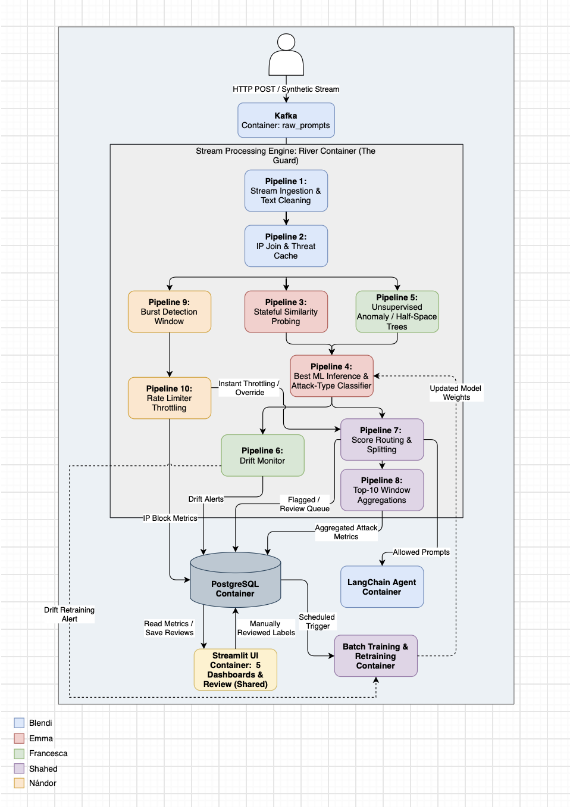

# Architecture and work plan

## Flow of Prompt-injection and Jailbreak Guard

Docker Compose runs the services together: Kafka carries incoming prompts, Python streaming workers (using River where appropriate) process them, and PostgreSQL stores metrics, alerts and reviewed labels. The guard cleans and enriches prompts, combines similarity/anomaly signals with the selected ML model, and routes allowed prompts to the LangChain agent while flagged prompts enter review. Streamlit provides five dashboards and a shared review interface; scheduled or drift-triggered batch retraining uses reviewed labels and supplies evaluated model updates to P4.

### Implemented intake milestone

The current path is **browser → Flask → `prompts_raw` → one Python consumer (P1/P2) → PostgreSQL**.
Docker Compose starts Flask, the intake and burst workers, Kafka and PostgreSQL; a one-shot initialization
service creates the tables and topics. The consumer is the entry point for future guard stages.
It saves original prompts, P1/P2 preprocessing, and a `pending` decision atomically;
it does not classify or invoke an agent. P1 derives an NFC/whitespace-cleaned copy
and original-text character/word/symbol features. P2 supplies per-source allow,
block, and review counts from the last ten minutes of checked decisions, with a
30-second process-local cache. These fields are stored in `prompts.preprocessing`;
matching redelivery preserves the first snapshot and any completed verdict.
Existing rows remain valid without a snapshot until redelivered. History counts
exclude pending records and ground-truth dataset labels, and are context rather
than routing/throttling decisions.

The `backend.intake.replay` command reads imported dataset rows, selecting by
dataset/split and optional label/attack group, and publishes the same raw events
at a configurable rate with round-robin simulated sources. Each new submission
has a fresh UUID and retains its dataset link. Invalid/overlength rows are skipped
without truncation; successive invocations provide burst/drift test traffic.
Separately, the optional LangChain/Ollama worker consumes `prompts_allowed`, checks the stored
`allow` decision, and records outcomes in `agent_runs`. A temporary guard stub supplies that
demo path; neither the stub nor the agent is started by the default intake stack.

The diagram and Excel work plan describe the full target. Their `raw_prompts` label maps to
the implemented `prompts_raw`; `clean_prompts` maps to the implemented `prompts_allowed` agent
topic. `prompts_labels` is reserved; P10 publishes `throttle_decisions` for P7 routing.

The version-two JSON event has `schema_version`, `prompt_id`, `text`, `source`, `created_at`
and nullable `dataset_prompt_id`. `source` is the source/IP identifier referred to as `source_ip`
in the work plan: Flask supplies the request IP, while the CLI accepts simulated identifiers.
Docker may expose a gateway IP for browser requests; simulated sources support later burst tests.
Ground-truth labels remain in `dataset_prompts`, outside the prompt event.

Flask returns HTTP 202 after Kafka acknowledges a prompt. The consumer stores the prompt and
pending result atomically, then commits its Kafka offset. Matching redelivery does not overwrite
a stored decision. Invalid events are logged with topic/partition/offset and skipped; transient
storage or offset failures stop the consumer for Compose to restart. See the [README](../README.md)
for commands and the [database sketch](database-schema.dbml) for the current schema.
The database PNG predates the preprocessing column and source index; DBML/SQL
describe the current schema. P1/P2, P7/P8, and P9/P10 are implemented; P3–P6 remain planned.

### Implemented P9–P10: burst detection and rate limiting

A separate `burst` worker (`backend/stream/`, group `pijd-burst-v1`) also reads `prompts_raw`.
P9 counts all prompts per source in a sliding event-time window; it needs no classifier score,
matching its position beside P3/P5. P10 blocks a source for a cooldown once the window reaches a
threshold (defaults: 10 prompts in 60 s, 300 s block). For every prompt, P10 stores its decision
in the `throttle_decisions` table (IP block metrics, kept for learning) and publishes it to the
`throttle_decisions` topic keyed by `prompt_id`. P7 consumes that topic: `block` is an instant
override before score routing, `allow` leaves routing to the model scores. The event contract is
in the [README](../README.md#burst-detection-and-rate-limiting-p9p10).

Both workers can create the raw prompt row. If the burst worker stores it first,
the intake worker fills its null preprocessing; if intake runs first, burst storage
preserves the snapshot. Each worker has its own consumer group and offset commits.
P2 reads final `guard_results`, not the separate P10 decisions; throttling enters
the final verdict through P7.

### Implemented P7–P8: routing and attack aggregation

The `router` service consumes the existing `throttle_decisions` topic. P10 blocks immediately
finalize a prompt as blocked; P10 allows are joined to P4's score stored in `guard_results`.
Scores at or below `P7_ALLOW_MAX_SCORE` (default 0.30) allow, scores at or above
`P7_BLOCK_MIN_SCORE` (default 0.70) block, and the middle band enters review. If no score arrives
within `P7_SCORE_TIMEOUT_SECONDS` (default 30), P7 fails closed to review. Allow events are sent
to `prompts_allowed` through a PostgreSQL transactional outbox. P4 stores score/type/completion
time with the decision still pending; P7 is the final-decision writer.

The `aggregation` service refreshes a 60-second event-time window every 10 seconds. It counts
predicted P4 attack types and the top ten repeated P1-normalized prompt texts per type. P8 writes
the latest snapshot to `attack_aggregate_current`, appends timestamped snapshots to
`attack_aggregate_history`, and removes history older than seven days. Both workers and their
tables are initialized by the normal Compose startup.

## Stages and ownership

| Stages | Work | Owner |
| --- | --- | --- |
| P1–P2 | Stream ingestion/text cleaning; IP join and threat cache | Blendi |
| P3–P4 | Stateful similarity probing; best-model inference and attack-type classification | Emma |
| P5–P6 | Unsupervised anomaly detection / Half-Space Trees; drift monitoring | Francesca |
| P7–P8 | Score routing/splitting; Top-10 window aggregations | Shahed |
| P9–P10 | Burst detection window; rate limiting/throttling | Nándor |

These stages branch as shown in the diagram; they are not a single sequential P1–P10 chain. PostgreSQL, the review UI, batch retraining and integration are shared components; confirm individual batch owners together.

## Batch models and feedback

- **B1:** TF-IDF + Logistic Regression; **B2:** frozen transformer embeddings + Logistic Regression. Train on the cleaned NeurAlchemy `core` data, retaining `neuralchemy_v1` and excluding `control` and `chain_of_thought`.
- Compare B1/B2 on the same splits; select the binary model for P4 using validation macro-F1. Evaluate both on the standard test set and the entirely held-out deepset/prompt-injections and jackhhao/jailbreak-classification datasets. Report precision, recall, F1, FPR, ROC-AUC and latency alongside a length-only baseline. Holding out an attack family is optional.
- **B3:** classify malicious prompts by attack type; validate category groupings and counts before fixing the taxonomy. **B4:** retrain from reviewed labels on a schedule or following drift alerts; evaluate candidates before updating P4. External test datasets stay out of training and model selection.

## Timeline

1. **Oct 13–Nov 9:** establish Docker Compose, Kafka, PostgreSQL, datasets and shared event/database contracts.
2. **Nov 9-15:** develop the owned stages and batch models in parallel using fixtures and model stubs.
3. **Nov 15-22:** integrate the guard, agent, storage, five dashboards and review/retraining loop. Verify blocking, throttling, review persistence and model updates.
4. **Nov 22-26:** finish experiments, report, slides and clean-start deployment; original code-freeze target: Nov 23.
