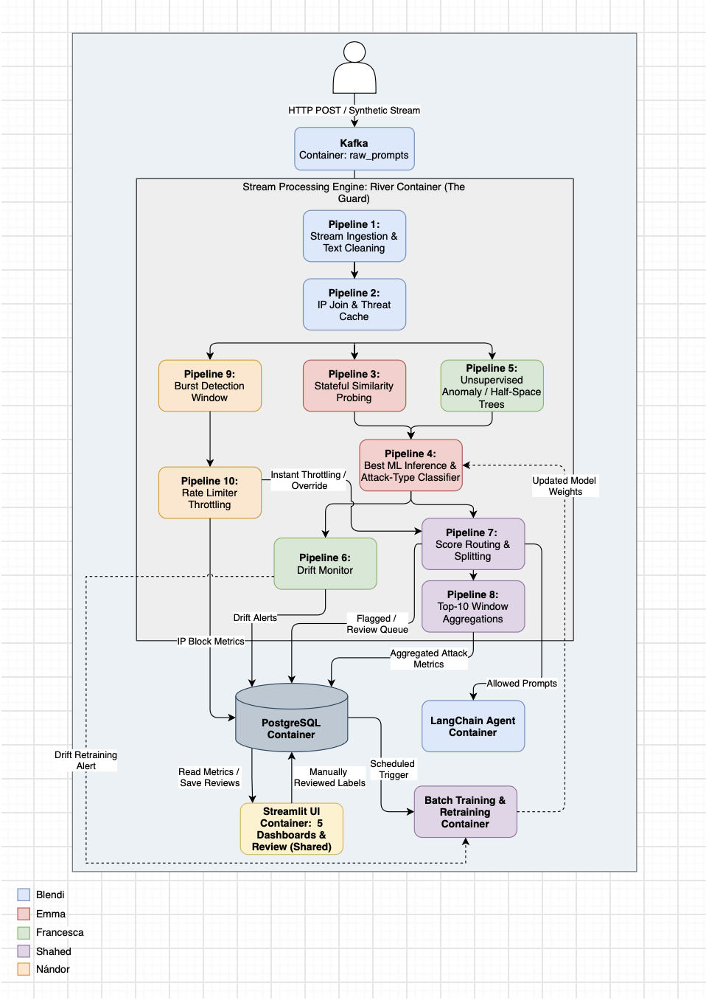

# Architecture and work plan

## Flow of Prompt-injection and Jailbreak Guard

Docker Compose runs the services together: Kafka carries incoming prompts, Python streaming workers (using River where appropriate) process them, and PostgreSQL stores metrics, alerts and reviewed labels. The guard cleans and enriches prompts, combines similarity/anomaly signals with the selected ML model, and routes allowed prompts to the LangChain agent while flagged prompts enter review. Streamlit provides five dashboards and a shared review interface; scheduled or drift-triggered batch retraining uses reviewed labels and supplies evaluated model updates to P4.

## Stages and ownership

| Stages | Work | Owner |
| --- | --- | --- |
| P1–P2 | Stream ingestion/text cleaning; IP join and threat cache | Blendi |
| P3–P4 | Stateful similarity probing; best-model inference and attack-type classification | Emma |
| P5–P6 | Unsupervised anomaly detection / Half-Space Trees; drift monitoring | Francesca |
| P7–P8 | Score routing/splitting; Top-10 window aggregations | Shared |
| P9–P10 | Burst detection window; rate limiting/throttling | Nándor |

These stages branch as shown in the diagram; they are not a single sequential P1–P10 chain. PostgreSQL, the review UI, batch retraining and integration are shared components; confirm individual batch owners together.

## Batch models and feedback

- **B1:** TF-IDF + Logistic Regression; **B2:** frozen transformer embeddings + Logistic Regression. Train on the cleaned NeurAlchemy `core` data, retaining `neuralchemy_v1` and excluding `control` and `chain_of_thought`.
- Compare B1/B2 on the same splits; select the binary model for P4 using validation macro-F1. Evaluate both on the standard test set and the entirely held-out deepset/prompt-injections and jackhhao/jailbreak-classification datasets. Report precision, recall, F1, FPR, ROC-AUC and latency alongside a length-only baseline. Holding out an attack family is optional.
- **B3:** classify malicious prompts by attack type; validate category groupings and counts before fixing the taxonomy. **B4:** retrain from reviewed labels on a schedule or following drift alerts; evaluate candidates before updating P4. External test datasets stay out of training and model selection.

## Timeline

1. **Oct 13–25:** establish Docker Compose, Kafka, PostgreSQL, datasets and shared event/database contracts.
2. **Oct 26–Nov 10:** develop the owned stages and batch models in parallel using fixtures and model stubs.
3. **Nov 11–19:** integrate the guard, agent, storage, five dashboards and review/retraining loop. Verify blocking, throttling, review persistence and model updates.
4. **Nov 20–25:** finish experiments, report, slides and clean-start deployment; original code-freeze target: Nov 23.
