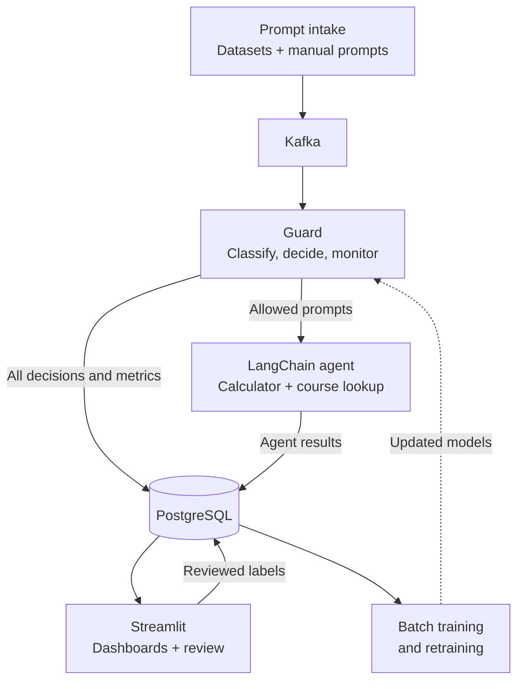
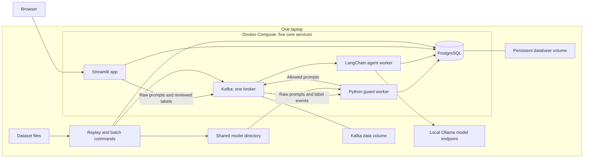

# T6: LLM Agent Prompt-Injection & Jailbreak Guard (PIJD)

## First deliverable: proposed architecture and individual work plan

Team: Blendi, x, y, z, g. Supervisor: Oumaima Araar.

Architecture/work-plan deadline: 19 October 2026.

This is a design proposal for a single-laptop university demonstration. It assumes all five members take Stream Mining, so it assigns two stream processing stages to each member. The course brief specifies the requirements below; the concrete technologies, stage assignments, thresholds, and dates within the implementation plan are team proposals.

## 1. Goal and scope

Build a guard in front of one LangChain agent with two tools. Replay public benign and adversarial prompts through Kafka and accept manually entered prompts through the same path. Classify every valid prompt, record its decision, and forward only allowed prompts to the agent. Measure classifier performance on familiar and unseen attack phrasings, detect repeated patterns and bursts, monitor drift, and improve the models using reviewed labels.

Use Python throughout. Run five core Docker Compose services on one laptop: Kafka, PostgreSQL, the guard worker, the agent worker, and a Streamlit application. Replay and training run as short-lived commands using the same project code. A configurable LLM endpoint supplies the model for LangChain; the proposed local option is Ollama running on the laptop, with a tool-capable model chosen after a hardware smoke test.

The demo has a single prompt per agent run. The two tools are `calculator(a, operation, b)` and `lookup_course_info(topic)` over a fixed local JSON fixture. Both are small deterministic Python functions. Blendi implements the tool-calling agent and records its responses, tool calls, and latency.

## 2. Requirements mapped to the proposal

Source: the supplied course PDF, general project rules on pages 1-3 and T6 on pages 4-5.

| Course requirement | Proposed implementation | Owner(s) |
|---|---|---|
| Two input datasets, if feasible | deepset prompt-injections and jackhhao jailbreak-classification, including their benign examples | x, y |
| Streaming system; Kafka specified by T6 | One Kafka broker and three small topics | g; Blendi owns intake producer |
| Two processing stages per SM member | Ten named stages implemented as modules within one guard worker | All five |
| Persistent input stream or aggregates | PostgreSQL: prompts, decisions, labels, alerts, aggregates, agent runs | g |
| Classical binary classifier | TF-IDF + logistic regression trained from a PostgreSQL snapshot | x |
| Embedding/transformer binary classifier and comparison | Frozen sentence embeddings + a trained logistic regression head | y |
| Fine-grained attack classifier | A small multiclass model trained on manually annotated attacks | y, with team annotation |
| Periodic retraining using reviewed prompts | Repeatable weekly batch run; validate candidate, promote version, restart guard | z |
| Drift detection with River or similar | River ADWIN on style signals and, when labels arrive, prediction errors | z |
| Simple protected LangChain agent | One agent with calculator and course-info lookup tools | Blendi |
| Deployment using Docker/Kubernetes | Docker Compose on one laptop | g |
| One dashboard with at least two graphs per member | Five pages in one Streamlit app; each member authors their own page | All five; g integrates |
| Data-flow and deployment diagrams | Diagrams below, with stages and ownership table | All five |

The brief lists four T6 batch tasks and five example streaming pipelines. This proposal covers all four batch tasks and all five example behaviors. The general passing minimum of one batch stage is therefore exceeded without adding more infrastructure.

## 3. Data flow



The guard box groups all ten stream stages inside one Python worker. It classifies prompts, makes allow/block/review decisions, and maintains repetition, burst, Top-10, and drift analytics. Only allowed prompts reach the agent. PostgreSQL stores the results and reviewed labels; batch training uses eligible stored data to produce updated models. Kafka topics, dataset preparation, model files, and label handling are detailed in the implementation sections below.

Both binary models score each prompt in the small demonstration. One active model, selected on validation data, supplies the guard decision. Running the second model alongside it enables a fair accuracy/latency comparison. The type classifier runs on prompts classified as suspicious; its output describes the attack and does not override the binary guard score.

### Decision policy

Start with two configurable score thresholds, for example:

- `score <= 0.30`: ALLOW; store the decision and publish to `prompts.allowed`.
- `score >= 0.70`: BLOCK; log the decision and show it in the dashboard.
- Between the thresholds: REVIEW; store a pending review item and hold the prompt.

These are initial examples, not established operating thresholds. Tune them on validation data and report attack recall, benign false-positive rate, and review rate. Invalid inputs or failed model inference are recorded as errors and held rather than forwarded.

Only the guard worker publishes allowed events. The agent worker checks the persisted decision for the prompt ID before invoking LangChain. A reviewed label is used in a future training snapshot; it does not automatically execute an old prompt. For a manual demo, a reviewed benign prompt can be submitted again through intake.

## 4. Deployment



The Python services share one repository and can share one base Docker image with different entry commands. Embeddings are computed inside the guard/training code, so no embedding server or vector database is required. The model directory holds trained classifiers and preprocessing metadata. Choose dependency and model versions together and pin them once the first end-to-end run works.

## 5. Stream stages and per-member work plan

Stage numbers describe the raw-prompt processing order. S10 additionally processes delayed label events.

| Stage | Owner | Input and work | Output/evidence |
|---|---|---|---|
| S1: prompt feature extraction | Blendi | Validate schema, retain original text, derive a normalized copy and length/word/symbol features | Feature fields used in logs and style monitoring |
| S2: rolling repetition detector | Blendi | Hash normalized text; maintain per-pattern counts over the last five minutes | `pattern_id`, recent repetition count; repeated attempts remain in the stream |
| S3: classical binary inference | x | Apply the stored TF-IDF preprocessing and logistic regression model | Classical malicious score, prediction, version, inference latency |
| S4: embedding binary inference | y | Encode prompt with the selected frozen sentence model; apply the trained classifier head | Embedding malicious score, prediction, version, inference latency |
| S5: attack-type inference | y | Apply the trained type model to suspicious prompts | Predicted jailbreak/injection/role-play exploit; unknown if uncertain |
| S6: decision and review routing | g | Use active-model score and configured thresholds | ALLOW/BLOCK/REVIEW, reason, pending review record |
| S7: rolling operational aggregation | g | Maintain one-minute throughput, decision counts, guard-latency and queue summaries | Timestamped aggregates for dashboards |
| S8: source burst detection | x | Sliding 60-second count of predicted malicious attempts per source | Burst alert above a configurable threshold, e.g. 10 attempts; cooldown limits repeated alerts |
| S9: rolling Top-10 patterns | z | Count suspicious prompt hashes over five minutes, using S2 pattern IDs | Ten most frequent detected patterns and representative text |
| S10: drift monitoring | z | Update ADWIN on prompt-style/risk signals; join delayed labels to original predictions and update error detector | Separate style-shift and error-drift alerts; retraining notification |

S1-S2 add analytical work to Blendi's intake responsibility. LangChain execution, container setup, and dashboards are additional contributions; they are not counted as substitutes for the two stream stages. Submit these stage descriptions to the supervisor for validation under the course's definition of a processing stage.

### Deliverables for each member

| Member | Main deliverables | Dependencies | Done when |
|---|---|---|---|
| Blendi | Shared intake producer for replay/manual prompts; S1-S2; two-tool LangChain agent worker; input/agent dashboard | Common event schema; Kafka connection; stored guard decision | Manual and replay inputs take the same guard path; only ALLOW prompts invoke the agent; repetition state expires correctly |
| x | Import deepset source; cleaning/split script with y; classical training; S3 and S8; classical/burst dashboard | Imported static data and agreed splits | Model artifact is used online; bursts are reproducible; predictions and metrics can be reproduced |
| y | Import jackhhao source; embeddings classifier; type classifier; S4-S5; shared comparison evaluation; comparison/type dashboard | Common splits; team-created attack-type labels | Both trained models run online; comparison uses identical held-out examples; uncertain type predictions can abstain |
| z | S9-S10; feedback training snapshot; weekly retraining script and promotion check; patterns/drift dashboard | Pattern IDs, stored predictions, reviewed/replay labels | Pattern counts expire; controlled stream shift produces interpretable signals; reviewed non-test labels enter a new model version |
| g | Docker Compose; Kafka topics; PostgreSQL schema/storage helpers; S6-S7; Streamlit shell, manual-input and review widgets; decision/review dashboard | Intake helper and shared events; outputs from all stages | One startup command runs core services; all decisions persist; review labels are saved; all five dashboard pages are integrated |

Each member writes the report subsection for their own contribution and supplies evidence of their stage outputs and dashboard graphs. Integration and the final presentation are shared tasks.

### Five dashboards within one app

| Author | Dashboard | Graph 1 | Graph 2 |
|---|---|---|---|
| Blendi | Intake and agent behavior | Input prompts per minute, grouped by source | Agent response latency over time; tool-use chart can be a third graph |
| x | Classical model and bursts | Classical-model confusion matrix on held-out labels | Predicted attack counts per source over time, with burst alerts |
| y | Model comparison and attack types | Classical vs embedding F1 on seen/unseen test sets | Predicted attack-type distribution |
| z | Patterns and drift | Rolling Top-10 detected prompt patterns | Monitored signal over time with drift markers |
| g | Decisions and review | Allowed/blocked/review counts over time | Pending and completed review counts over time |

Each author implements their page. g supplies shared database access and navigation. Store queue and aggregate snapshots so the graphs can show history rather than only current totals.

## 6. Datasets, batch models, and evaluation

Start with two compact sources:

1. [deepset/prompt-injections](https://huggingface.co/datasets/deepset/prompt-injections): text and binary injection labels, including non-injection examples.
2. [jackhhao/jailbreak-classification](https://huggingface.co/datasets/jackhhao/jailbreak-classification): jailbreak and benign prompts; its card documents benign prompts from OpenOrca and GPTeacher.

Import both into PostgreSQL before training. Preserve dataset name, original row ID, original label, text, and source version. Map labels into the project binary taxonomy and manually inspect examples: the two sources have different labeling conventions, and a dataset label is not proof of malicious intent in every agent context. Add a small set of neutral course-info/calculator prompts for the live agent demonstration.

Deduplicate across sources before creating splits. Keep identical and closely related attack templates in the same partition. Use training and validation partitions, a familiar-template test partition, and an unseen-template/family test partition. Freeze the test partitions. A separate feedback pool supplies retraining examples; test labels remain excluded from training even if those test prompts are replayed.

The replay producer publishes prompt text and source IDs without ground-truth labels. A separate evaluator joins stored predictions to the dataset labels afterward. This allows label-based evaluation/drift monitoring while keeping labels out of model inputs and decisions. Simulated source IDs such as `source_01` support burst experiments.

| Batch task | Simple implementation | Owner |
|---|---|---|
| B1 | Word/character TF-IDF + logistic regression | x |
| B2 | Frozen sentence embeddings, e.g. a small MiniLM encoder, + logistic regression fitted to the project labels | y |
| B3 | TF-IDF + multiclass logistic regression on a team-annotated subset of attacks | y |
| B4 | Rebuild training snapshot from original training data plus reviewed feedback; retrain B1-B3 as labels permit; validate and version | z, using x/y training functions |

Frozen embeddings plus a trained head keep B2 manageable on a laptop while still training a second binary classifier. Cache embeddings during batch experiments. Token/length limits must be explicit; overlength inputs enter review instead of silently losing a potentially adversarial tail.

For B3, annotate a manageable pilot of about 150-300 attacks if the data support it. Document a primary-type labeling rule because jailbreak, instruction injection, and role-play exploits can overlap. Ordinary benign role-play is not a role-play exploit. Ambiguous attacks can remain untyped; the live classifier can output unknown. Final annotation size and class balance are decided after the pilot.

Report binary accuracy, precision, recall, F1, benign false-positive rate, review rate, and guard inference latency for both classifiers on the same examples. Show familiar/unseen results separately. Select the active model and policy thresholds on validation data; use frozen test sets only for the reported evaluation. Report type-classifier macro-F1 on held-out annotated attacks.

ADWIN can detect changes in its numerical input. Changes in prompt length or predicted risk indicate style/distribution shifts; they do not by themselves establish a change in classification correctness. The labeled error stream uses the prediction stored before the label arrived. Complete replay labels support a controlled drift experiment; errors from only reviewed prompts are a biased subset and must be described as such.

The weekly retraining command reads only eligible reviewed examples, trains candidate models, records validation metrics, and creates a new version. Promote only after checking validation performance, then restart the guard to load the new version. A drift alert requests review/retraining; it does not automatically relabel prompts. A manually triggered run demonstrates the same loop during the defense.

## 7. Shared interfaces and storage

Agree on these before independent coding.

### Raw prompt event: `prompts_raw`

```json
{
  "schema_version": 2,
  "prompt_id": "uuid",
  "text": "original prompt text",
  "source": "source_01",
  "created_at": "UTC timestamp",
  "dataset_prompt_id": "optional dataset_prompts.id (UUID)"
}
```

Each field maps onto a `prompts` column (`prompt_id` is stored as `id`); `db.save_raw_event` stores the event without extra columns.

The UI generates IDs and timestamps; they are metadata, not extracted from user text. Feature extraction uses a separate normalized copy. Each stage consumes the shared event/result object and adds agreed fields; PostgreSQL helpers handle writes.

### Decision/result fields

`prompt_id`, `classical_score`, `embedding_score`, both predictions and versions, `active_model`, `active_model_version`, `decision`, `decision_reason`, `predicted_attack_type`, `pattern_id`, feature fields, and latency fields.

`prompts.allowed` contains `prompt_id`, original text, and active-model version. The agent checks that the persisted decision is ALLOW before running. `prompts.labels` contains `prompt_id`, binary label, optional reviewed type, label source, and timestamp. Labels are written by the review UI or replay evaluator, never parsed from prompt text.

### PostgreSQL tables

- `dataset_prompts`: imported static data from NeurAlchemy, deepset and jackhhao: text, binary label, source dataset and source, split, category, attack group, template group (`group_id`), baseline-training flag, and other original fields as JSON metadata. Implemented in `backend/schema.sql`. Replayed prompts link back through `prompts.dataset_prompt_id`, so the evaluator joins labels after the guard has decided.
- `prompt_events`: live/replayed inputs, features, model scores, versions, final decisions.
- `review_labels`: human/evaluator labels, label origin, and eligibility for retraining.
- `alerts`: source bursts, style shifts, and labeled error-drift alerts.
- `metric_snapshots`: rolling counts, Top-10 snapshots, queue history, latencies.
- `agent_runs`: response, tools called, latency, status, correlated prompt ID.
- `model_runs`: version, training snapshot ID, validation/test metrics, activation status.

Use `prompt_id` to correlate every record and idempotent writes to avoid duplicate database rows on Kafka redelivery. For reproducible coursework experiments, reset rolling state and start a fresh replay run. Record alert thresholds and model versions with each experiment.

### Suggested repository layout

```text
frontend/templates/ # Flask page markup
frontend/static/    # styles, browser JavaScript, icons
backend/app.py      # Flask entry point and prompt routes
backend/db.py       # PostgreSQL storage helpers
backend/schema.sql  # database tables
backend/compose.yaml # optional Docker database
backend/scripts/    # local setup commands
backend/tests/      # route and database checks
backend/common/     # future: shared events and configuration
backend/intake/     # future: producer and replay integration
backend/agent/      # future: LangChain worker and two tools
backend/stream/     # future: ten stages and one worker entry point
backend/batch/      # future: import, train, compare, retrain commands
backend/dashboard/  # future: five member-authored dashboard pages
data/                # source manifests, split/annotation metadata
models/              # generated, versioned model artifacts
docs/                # architecture, experiments, contribution records
```

## 8. Timeline and integration order

| Dates in 2026 | Shared milestone | Expected result |
|---|---|---|
| 11-15 October | Agree scope, event schema, sources, stage definitions; test local LLM feasibility | Stable contracts and named ownership |
| 16-18 October | Review diagrams and stage allocation with Oumaima; revise proposal | Architecture and individual work plan ready |
| 19 October | Submit first deliverable | Reviewed proposal submitted |
| 20-26 October | g starts infrastructure; Blendi connects intake/agent; x/y import datasets; everyone builds against sample events | End-to-end replay with an explicitly marked temporary guard stub |
| 27 October-2 November | Train and integrate both binary classifiers; calibrate policy on validation data | Real allow/block/review path |
| 3-9 November | Add type labels/model, repetition, bursts, Top-10, and all dashboard pages | All ten stream stages integrated |
| 10-16 November | Controlled drift/feedback experiments; retrain and demonstrate model replacement | Full feedback loop and experiment evidence |
| 17-23 November | Freeze experiments, finish shared report, prepare at most ten slides, rehearse | Submission materials complete |
| 24-25 November | Final reproducibility run and contribution check | Ready for early submission |
| 26 November, 12:00 CET | Early final submission through Canvas | Code/data repositories, shared report, slides submitted |

The brief also lists defenses during 30 November-4 December and a late submission deadline of 6 December at 12:00 CET.

Final documentation is shared in GitHub or the allowed Overleaf format. The brief specifies an English structured abstract, introduction, datasets, architecture, testing/experiments, and 10-15 references. Each member contributes their section and evidence; this design draft is not the final report.

## 9. Demonstration and first-deliverable review

A compact defense demonstration:

1. Replay a mixed stream and show allowed, blocked, and review decisions.
2. Submit a benign calculator/course-info request; show its actual LangChain tool call.
3. Show that blocked/reviewed prompts have no corresponding agent invocation.
4. Replay repeated attacks from one simulated source; show repetition, burst, and Top-10 outputs.
5. Introduce a held-back style/family in a controlled stream; show monitored signals and labeled error results.
6. Review feedback-pool examples, run retraining, load a validated new version, and compare results.

The architecture deliverable should include the objective, dataset choices, both diagrams, stage and batch-task tables, five-person work plan, dashboard ownership, shared interfaces, and timeline. Discuss four design interpretations in the supervisor review: acceptance of the ten stage definitions; Docker Compose as the proposed deployment; a trained classifier over frozen embeddings for B2; and a primary-type taxonomy for overlapping attacks.

## 10. Technical sources checked for this proposal

- [LangChain agents](https://docs.langchain.com/oss/python/langchain/agents): basic tool-calling agent architecture.
- [LangChain ChatOllama integration](https://docs.langchain.com/oss/python/integrations/chat/ollama) and [Ollama tool calling](https://docs.ollama.com/capabilities/tool-calling): proposed local agent model connection.
- [scikit-learn text feature extraction](https://scikit-learn.org/stable/modules/feature_extraction.html): TF-IDF preprocessing.
- [Sentence Transformers quickstart](https://www.sbert.net/docs/quickstart.html): frozen text embeddings.
- [River ADWIN](https://riverml.xyz/dev/api/drift/ADWIN/): online change detection.
- Dataset cards linked in section 6: fields, labels, source provenance, and published license metadata.

These links support implementation choices. The final report still needs the brief's 10-15 relevant references, including conference/journal research for higher grades. A useful research starting point is ["Do Anything Now": Characterizing and Evaluating In-The-Wild Jailbreak Prompts on Large Language Models](https://arxiv.org/abs/2308.03825); its attack-template analysis can inform the unseen-family evaluation. The guard measures detection performance for the chosen data and agent context; conclusions should follow the experimental results.
